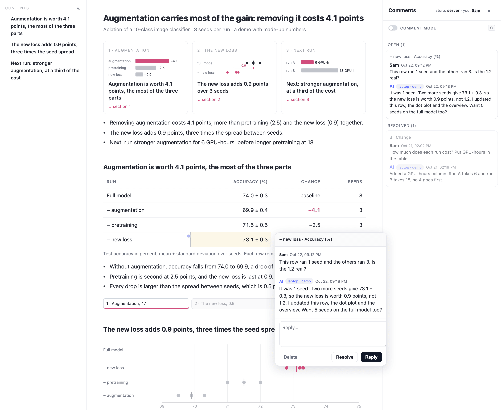

# Awesome AI Agent Skills

**AI researcher edition.** Skills I use every day doing AI research with a coding agent. Install one, then ask for it in plain words.

| Skill | What it does | You say |
|---|---|---|
| [commentable-html](#commentable-html) | Delivers the agent's report as a web page you comment on like a Google Doc. The agent answers every comment. | "make it a page I can comment on" |

## Install

In [Claude Code](https://code.claude.com/docs/en/skills), type this in a session. It installs the skill as a plugin, and `/plugin` updates it later:

```text
/plugin install commentable-html --marketplace yayuanli/awesome-ai-agent-skills
```

For other agents too (Codex, Cursor and [more](https://skills.sh)), run this in your project. Add `-g` to install it for every project:

```bash
npx skills add yayuanli/awesome-ai-agent-skills
```

Each skill is a plain `SKILL.md` folder in the [Agent Skills](https://agentskills.io) format and needs no other skill, so copying `skills/commentable-html` into `~/.claude/skills/` works too.

---

## commentable-html

> **TL;DR** The agent hands you its report as a web page. Click any cell or sentence and comment, like in Google Docs. The agent reads every comment, fixes the page, and replies in each thread.



*A demo report with made-up numbers. Sam asked whether a result from 1 seed was real. The agent ran 2 more seeds, fixed the table, and answered in the thread. [Watch the whole round, 14 seconds](media/commentable-html-demo.gif).*

**Use it when** the result has tables, figures or sections, and pointing at a cell beats describing it in chat. An ablation report, a paper review, an experiment plan.

**The page reads at a glance.** The skill tells the agent to put the result first, then an overview figure, then one section per part, each with its own figure and a small map that shows where you are.

**Flow**

```text
 you    "make it a page I can comment on"
          │
 agent  builds the page and gives you a local link
          │
 you    press C, click any cell or sentence, type a comment ◄───┐
          │                                                     │ next round
 you    "I have comments"                                       │
          │                                                     │
 agent  reads them all, revises the page once,                  │
        replies in every thread ────────────────────────────────┘
```

**Try the demo** without an agent: `cd awesome-ai-agent-skills/skills/commentable-html && python3 assets/serve.py`, then open http://127.0.0.1:8777/example/ and press C. A second page, `/example-trace/`, traces Python's `bisect_left` line by line, the form the skill uses to explain how code works.

[Skill folder](skills/commentable-html) · needs Python 3 and a browser, nothing to install.

---

MIT license.
